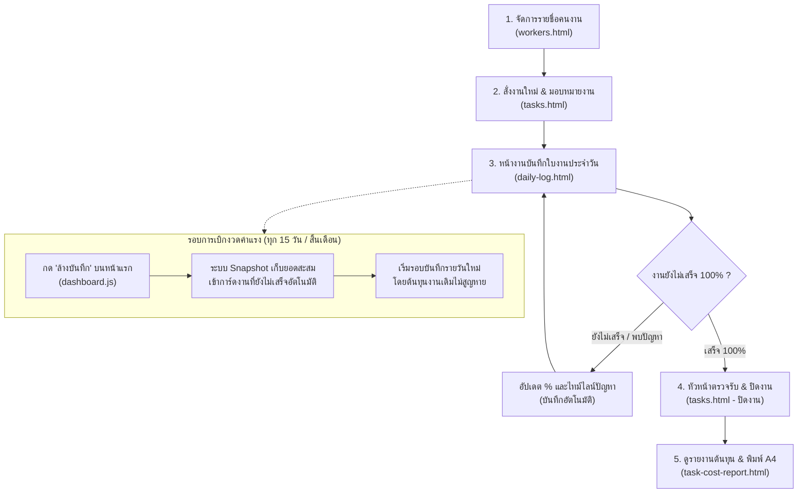

# คู่มือการใช้งานระบบคิดค่าแรงและติดตามงาน (Web-Work v3.0)
## ระบบสั่งงาน ติดตามความคืบหน้า และวิเคราะห์ต้นทุนค่าแรงตามชิ้นงาน

คู่มือนี้สรุปขั้นตอนการทำงาน (Workflow) ตั้งแต่เริ่มต้นสั่งงาน จนถึงการบันทึกรายวัน การตรวจรับงาน และการออกรายงานต้นทุนค่าแรง

---

## 🧭 แผนผังขั้นตอนการทำงาน (Step-by-Step Flowchart)

---

## 📋 ขั้นตอนที่ 1: ตรวจสอบและจัดการรายชื่อคนงาน (`workers.html`)
> **เหมาะสำหรับ:** ทำครั้งแรกเมื่อเริ่มระบบ หรือเมื่อมีคนงานเข้าใหม่/ปรับค่าแรง

1. เปิดเมนู **"👷 จัดการคนงาน"**
2. ใส่รหัส PIN: **`1225`**
3. กรอกข้อมูลคนงาน:
   * **ชื่อ-นามสกุล:** เช่น สมชาย ใจดี, เฟิร์น
   * **ค่าแรงขั้นต่ำต่อวัน (บาท):** เช่น 400, 500
   * **สถานะ:** ทำงานอยู่ (Active)
4. กด **"บันทึกคนงาน"**
> [!NOTE] 
> คนงานชื่อ **"เฟิร์น"** ระบบจะยกเว้นการบวก Markup +20% ทุกกรณีตามกฎการคำนวณของระบบ

---

## 📋 ขั้นตอนที่ 2: สร้างใบสั่งงานและมอบหมายงาน (`tasks.html`)
> **เหมาะสำหรับ:** ผู้จัดการ / วิศวกร / หัวหน้างาน เมื่อมีงานหรือคำสั่งงานใหม่

1. เปิดเมนู **"📋 สั่งงานและติดตามงาน"**
2. คลิกปุ่ม **"➕ สั่งงานใหม่"**
3. กรอกข้อมูลคำสั่งงาน:
   * **ชื่องาน / รายละเอียดคำสั่ง:** เช่น *งานเทเสาชั้น 2, ก่ออิฐมวลเบาห้องน้ำ*
   * **ไซต์งาน (Site):** เช่น *ไซต์สุขุมวิท 101*
   * **ตำแหน่ง / โซน:** เช่น *โซน B อาคาร 1 ชั้น 2*
   * **ผู้รับผิดชอบ / หัวหน้าช่าง:** เลือกหรือพิมพ์ชื่อคนงานที่ดูแล
   * **ผู้สั่งงาน:** เช่น *วิศวกรธีรเดช*
   * **วันที่สั่งงาน & กำหนดแล้วเสร็จ (Due Date)**
   * **รายละเอียดเพิ่มเติม:** เครื่องมือ ข้อควรระวัง หรือสเปกงาน
4. กด **"บันทึกใบสั่งงาน"**
   * ระบบจะสร้างรหัสงานอัตโนมัติ เช่น **`TSK-202611-001`**
   * สถานะเริ่มต้นจะเป็น **`รอดำเนินการ (Pending)`** และความคืบหน้า **0%**

---

## 📋 ขั้นตอนที่ 3: หน้างานลงบันทึกประจำวัน (`daily-log.html`)
> **เหมาะสำหรับ:** หัวหน้าชุดช่าง / โฟร์แมน บันทึกการทำงานตอนสิ้นวัน

1. เปิดเมนู **"📝 บันทึกงานประจำวัน"**
2. **เลือกงานที่ได้รับมอบหมาย (ถ้ามี):**
   * คลิกเลือกใบสั่งงานจากดรอปดาวน์ เช่น `[TSK-202611-001] งานเทเสาชั้น 2 (ไซต์สุขุมวิท 101)`
   * **ระบบจะเติมชื่อไซต์งาน, รายละเอียดงาน และผู้สั่งงานให้อัตโนมัติทันที**
3. **กรอกความคืบหน้าของงานวันนี้:**
   * **ความคืบหน้า (%):** ระบุเปอร์เซ็นต์สะสมของงาน เช่น วันนี้ทำได้ 40%
   * **ปัญหาที่พบหน้างาน (ถ้ามี):** เช่น *ฝนตกช่วงบ่าย 1 ชั่วโมง*
   * **แนวทางแก้ไข:** เช่น *กางผ้าใบคลุม เลื่อนเวลาเทปูน*
4. **เลือกคนงานและลงเวลา:**
   * ติ๊กเลือกคนงานที่มาทำงาน
   * ระบุจำนวนชั่วโมงปกติ (เช่น 8 ชม.) และ OT (ถ้ามี) หรือเลือกเป็นแบบเหมาจ่าย
5. **แนบรูปถ่ายหน้างาน (ถ้ามี):** สูงสุด 6 รูป
6. กด **"บันทึกงาน"**
   * ระบบจะคำนวณค่าแรงรายวัน
   * สถานะของ Task จะเปลี่ยนเป็น **`กำลังดำเนินการ (In Progress)`** โดยอัตโนมัติ
   * ประวัติความคืบหน้าและปัญหาจะถูกส่งเข้า **Timeline** ของงานนั้นอัตโนมัติ

> [!TIP]
> **กรณี 1 วันทำหลายงาน:** สามารถบันทึกแยกใบงานได้ เช่น เช้าทำ Task A (4 ชม.) กดบันทึก จากนั้นเปิดบันทึกอีกใบสำหรับบ่ายทำ Task B (4 ชม.) ระบบจะเฉลี่ยต้นทุนค่าแรงแยกเข้าแต่ละงานอย่างแม่นยำ

---

## 📋 ขั้นตอนที่ 4: ตรวจรับงานและปิดงาน (`tasks.html`)
> **เหมาะสำหรับ:** หัวหน้างาน / ผู้จัดการ เมื่อลูกน้องทำงานครบ 100%

1. เมื่อลูกน้องลงบันทึกในใบงานจนความคืบหน้าแตะ 100% สถานะงานจะยังคงอยู่เพื่อรอการตรวจรับจริง
2. หัวหน้างานเปิดหน้า **"📋 สั่งงานและติดตามงาน"**
3. คลิกปุ่ม **"✅ ปิดงาน"** ที่การ์ดงานนั้น
4. กรอก **"สรุปผลการทำงานจริง & หมายเหตุการตรวจรับ"**:
   * เช่น *ตรวจรับงานเทเสาเรียบร้อย ระดับได้มาตรฐาน ช่างทำงานเสร็จทันกำหนด*
5. กดยืนยันปิดงาน
   * สถานะจะเปลี่ยนเป็น **`เสร็จสมบูรณ์ (Completed)`**

---

## 📋 ขั้นตอนที่ 5: ดูรายงานสรุปต้นทุนตามชิ้นงาน (`task-cost-report.html`)
> **เหมาะสำหรับ:** เจ้าของงาน / บัญชี / ฝ่ายประเมินราคา เพื่อดูต้นทุนจริงและคิดเงินลูกค้า

1. เปิดเมนู **"📊 สรุปต้นทุนตามงาน"** (หรือกดปุ่ม **"📊 ต้นทุนค่าแรง"** จากการ์ดงานในหน้าสั่งงาน)
2. เลือกรหัสใบสั่งงานที่ต้องการดู ระบบจะแสดงผลวิเคราะห์ต้นทุนทันที:
   * **จำนวนวันทำงานจริง:** ทำไปทั้งหมดกี่วัน
   * **จำนวนแรงงานรวม (Man-Days):** ใช้แรงงานไปทั้งหมดกี่แรง (และชั่วโมงรวมกี่ชั่วโมง)
   * **ต้นทุนค่าแรงจริง (Raw Cost):** ยอดเงินค่าแรงจริงที่จ่ายให้คนงาน
   * **ยอดคิดเงินลูกค้า (+20% Markup):** ยอดบวกเพิ่มสำหรับตั้งเบิก
   * **ตารางแจกแจงรายคน:** คนงานแต่ละคนทำไปกี่วัน กี่ชั่วโมง ได้รับเงินเท่าไหร่
   * **ประวัติปัญหาและการแก้ไข:** แสดงไทม์ไลน์ตั้งแต่วันแรกจนปิดงาน
3. คลิกปุ่ม **"🖨️ พิมพ์รายงานสรุป"** เพื่อพิมพ์ลงกระดาษ A4 หรือบันทึกเป็น PDF ส่งผู้บริหารหรือลูกค้าได้ทันที

---

## 🔄 ระบบการเบิกงวดและการยกยอดสะสม (Carry-Over Snapshot)
> **สถานการณ์:** งานหนึ่งชิ้นใช้เวลาทำนานข้ามเดือน (ข้ามรอบเบิกงวดค่าแรง)

* เมื่อครบงวดเบิกเงิน (เช่น ทุกวันที่ 15 หรือสิ้นเดือน) และคุณกดปุ่ม **"🗑️ ล้างบันทึก"** ที่หน้าแรก (`index.html`) เพื่อเริ่มรอบใหม่
* **ระบบจะทำ Snapshot อัตโนมัติ:** นำยอดเงินค่าแรงและจำนวนแรงงานของงานที่ยังไม่เสร็จ บันทึกฝังไว้ในตัวงานนั้น (`accumulated_*`) ก่อนที่จะล้างใบงานรายวัน
* เมื่องวดถัดไปลูกน้องมาลงงานต่อ ยอดค่าแรงใหม่จะถูกนำไปรวมกับยอดยกมาจากงวดก่อนหน้า ทำให้**ข้อมูลต้นทุนรวมของงานไม่สูญหาย 100%**
